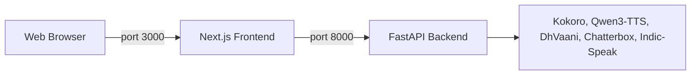

<p align="center">
  <h1 align="center">🦜 BonClay - Backend</h1>
  <p align="center"><strong>Voice cloning with consent, speech in 22 Indian languages, and voice agents.</strong></p>
  <p align="center">
    <a href="#features">Features</a> •
    <a href="#architecture">Architecture</a> •
    <a href="#installation">Installation</a> •
    <a href="#usage">Usage</a>
  </p>
</p>

---

The BonClay API server. Upload a short voice sample (5-10 seconds), record a spoken consent, and generate speech in that voice with **Qwen3-TTS 0.6B** (10 languages, on the Apple GPU through MLX on a Mac). Your consented voice can also speak Indian languages (Hindi, Marathi, Tamil, Bengali, Telugu, Kannada, Malayalam, Gujarati, Punjabi, Odia, Urdu and more) with **DhVaani-0.5** from ARTPARK-IISc (about 1.2-3x real time on an Apple M4), and Hindi with **Chatterbox Multilingual** (Resemble AI, MIT; the fallback, about 4-6x real time). They are for Studio renders, Say it once and pre-rendered clips, not live calls. Where DhVaani is not installed, other Indian languages use preset voices from **Indic-Speak** (22 languages) and **Kokoro-82M** (8 languages, fast). Live agents run speech recognition (Whisper), retrieval from your documents and a language model that can run fully on the Mac, so they work with no keys and no internet.

## ✨ Features

- **🎯 Voice Cloning With Consent** - Clone a voice from a few seconds of audio, after a spoken one-time consent sentence that is checked by speech recognition and a speaker match
- **⚡ GPU Accelerated** - Runs on the Apple GPU (MLX) on a Mac or on CUDA; falls back to CPU
- **🎙️ Dual Input Modes** - Record via microphone or upload audio files
- **📝 Optional Transcript** - Provide transcript for even better voice matching
- **🌐 Web Interface** - Modern Next.js React UI accessible from any browser
- **🔏 Provenance** - Every generated clip and agent reply carries an inaudible AudioSeal watermark and a signed receipt that anyone can check on the public `/verify` page
- **🚀 Easy Setup** - Simple installation with pip and npm

## 🏗️ Architecture

This project uses a split architecture:

- **Backend (Port 8000)**: Python/FastAPI server hosting the speech, cloning and agent models.
- **Frontend (Port 3000)**: Next.js React application for the user interface.

> **Note:** The frontend lives in `../frontend` in this repository. `./bonclay setup` and `./bonclay start` (in the repository root) run both services.



## 📋 Prerequisites

Before installing, ensure you have:

| Requirement  | Version   | Notes                          |
| ------------ | --------- | ------------------------------ |
| **Python**   | 3.10+     | Tested with 3.12               |
| **Node.js**  | 18+       | Required for frontend          |
| **GPU**      | Apple Silicon, or CUDA 8GB+ VRAM | Optional: without one, models run on the CPU, more slowly |
| **PyTorch**  | 2.0+      | With CUDA support on NVIDIA    |
| **SoX**      | 14.4.2+   | Audio processing library       |

### Installing SoX (Windows)

1. Download from: https://sourceforge.net/projects/sox/files/sox/
2. Install to `C:\Program Files\sox-14.4.2`
3. Add it to PATH

## 🚀 Installation

### 1. Clone the Repository

```bash
git clone https://github.com/Artifact19/bonclay.git
cd bonclay/backend
```

### 2. Backend Installation

Set up the Python environment for the API server.

```bash
# Create virtual environment
python -m venv .venv

# Activate (Windows)
.venv\Scripts\activate

# Install PyTorch with CUDA (Adjust for your version)
pip install torch torchvision torchaudio --index-url https://download.pytorch.org/whl/cu121

# Install dependencies
pip install -r requirements.txt
```

> **Kokoro voices:** `requirements.txt` installs Kokoro and its Mandarin support. The non-English voices also need the system package `espeak-ng` (`brew install espeak-ng` on macOS, `apt install espeak-ng` on Linux). Japanese is optional because its `pyopenjtalk` package compiles from source on install: run `pip install -r requirements-ja.txt` (needs a C++ compiler). Without it the Japanese voice is reported as unavailable and not offered; everything else keeps working.

> **Device and memory:** on a Mac the backend uses the Apple GPU (MPS) where it is safe and the CPU otherwise. On Windows or Linux with an NVIDIA GPU it uses CUDA. Set `MAX_GPU_MEMORY_GB` to control when models are unloaded (for example `3` on a 4 GB RTX 3050 Ti).
>
> **Voice cloning on Apple Silicon:** run `bash scripts/setup_mlx.sh` once (from `backend/`) so cloning runs on the Apple GPU through MLX, which is much faster than CPU. Without it, the Mac falls back to PyTorch on CPU. Windows or Linux with an NVIDIA GPU uses CUDA for cloning.
>
> **Indian-language speech (Indic-Speak):** run `bash scripts/setup_indic_speak.sh` once. It creates `backend/.venv-indic` and downloads the model (about 7 GB), so it needs about 8 GB of free memory to run. Before you run it, request access on the [model page](https://huggingface.co/bodhan-ai/indic-speak) (approved automatically) and put a Hugging Face token in `backend/.env` as `HF_TOKEN`. Indic-Speak has preset voices only (no cloning) and is slow on a laptop: about 8x real time on an Apple M4, so roughly a minute per sentence, and much faster on a CUDA GPU. Without it, Hindi and Marathi speech falls back to Kokoro's Hindi voice. Because it is slow, Indic-Speak is used for Studio renders, not live calls. It ships under the Indic Open Model License v1.0: the web app shows the required "Built with Indic-Speak from Bodhan AI / AI4Bharat." notice, and offering the model as an API to other organisations needs Bodhan AI's approval unless you are an academic or non-profit user. Run it from `backend/`.
>
> **Voice cloning in Indian languages (DhVaani, ARTPARK-IISc):** run `bash scripts/setup_dhvaani.sh` once (or `./bonclay setup --dhvaani` from the repository root). It creates `backend/.venv-dhvaani` and downloads the gated model (about 0.5 GB; about 1.3 GB with the environment); it needs `HF_TOKEN` in `backend/.env` for an account that has been granted access. A consented voice, even from an English sample, then speaks Hindi, Marathi, Tamil, Bengali, Telugu and more. DhVaani needs a 3-10 s reference clip and its exact transcript: a longer voice sample is cut at a pause and the cut is transcribed automatically (the pair is cached next to the voice and deleted with it). `INDIC_CLONE_ENGINE=auto|dhvaani|chatterbox` picks the engine; live agent and phone turns never use it. Credit: Voice cloning in Indian languages by DhVaani from ARTPARK-IISc. `backend/bench/dhvaani_live_check.py` measures it without the app server.
>
> **Hindi voice cloning (Chatterbox Multilingual, the fallback):** run `bash scripts/setup_chatterbox.sh` once (or `./bonclay setup --chatterbox` from the repository root). It creates `backend/.venv-chatterbox` and downloads the model (about 3 GB); no token is needed. Your consented voice, even from an English sample, can then speak Hindi. It runs on the CPU at about 4-6x real time, so it is for Studio renders and pre-rendered clips, not live calls. Chatterbox clones Hindi only; the other Indian languages need DhVaani. IndicF5 is an optional engine for a Hindi sample speaking Hindi and is not set up by default; see `../docs/decisions/indian-language-cloning.md`.
>
> **Agents with no keys:** speech recognition uses Groq Whisper when `GROQ_API_KEY` is set, otherwise Whisper on the Apple GPU (MLX) with CPU Whisper as a last fallback. The language model is Groq (Llama 3.3 70B) when a key is set, any OpenAI-compatible server, or Llama 3.2 3B on the Apple GPU (`bash scripts/setup_mlx.sh`). Show "Built with Llama" wherever Llama output is made available.

### 3. Frontend Installation

Set up the Next.js web interface.

```bash
cd frontend
npm install
# Return to root
cd ..
```

## 💻 Usage

You need to run **two separate terminals** to start the full application.

### Terminal 1: Start Backend

This starts the API server on port 8000.

**From the repo root:** `./bonclay start` (or `.\bonclay.ps1 start` on Windows) starts the API and the web app.

**Manual start:**

```bash
.venv\Scripts\activate
# Ensure SoX is in PATH
python -m uvicorn backend:app --host 0.0.0.0 --port 8000 --reload
```

Wait until you see `Application startup complete`.

### Terminal 2: Start Frontend

This starts the web UI on port 3000.

```bash
cd frontend
npm run dev
```

### Access the Web UI

Open your browser and navigate to:

```
http://localhost:3000
```

## 📝 Tips for Best Results

- Use **5-10 seconds** of clear, single-speaker audio
- Avoid background noise or music in reference audio
- Providing a **transcript** of the reference audio improves quality
- Works best with natural, conversational speech

## ⚙️ Configuration

Key parameters in `backend.py`:

| Parameter    | Default                         | Description                    |
| ------------ | ------------------------------- | ------------------------------ |
| `CLONE_ENGINE` | `qwen3_0_6b` (`Qwen/Qwen3-TTS-12Hz-0.6B-Base`) | Default voice-cloning engine |
| `DEVICE`     | `cuda:0`                        | GPU device (falls back to CPU) |

## 📐 Troubleshooting

- **QuotaExceededError**: Clear the browser's Local Storage if you generate too much history.
- **Port Conflicts**: Ensure ports 8000 and 3000 are free.
- **CORS Errors**: Ensure the backend is running and `localhost:3000` is in the allowed origins list in `backend.py`.

## 🙏 Credits

- **Cloning**: [Qwen3-TTS 0.6B](https://huggingface.co/Qwen/Qwen3-TTS-12Hz-0.6B-Base) by Alibaba (Apache-2.0) and [DhVaani-0.5](https://huggingface.co/ARTPARK-IISc/DhVaani-0.5) by ARTPARK-IISc (Indian languages) and [Chatterbox Multilingual](https://github.com/resemble-ai/chatterbox) by Resemble AI (MIT)
- **Preset voices**: [Kokoro-82M](https://huggingface.co/hexgrad/Kokoro-82M) (Apache-2.0) and Indic-Speak from Bodhan AI / AI4Bharat (Indic Open Model License v1.0)
- **Agents**: Whisper, a multilingual sentence-embedding model, and Llama (Llama community licence)
- **Watermark**: AudioSeal by Meta (MIT, including weights)
- **Backend Framework**: [FastAPI](https://fastapi.tiangolo.com/)
- **Frontend Framework**: [Next.js](https://nextjs.org/)

## 📜 License

This project is for educational and research purposes. Please respect the licenses of the underlying models and libraries:

- Kokoro-82M and Qwen3-TTS are Apache-2.0. Chatterbox is MIT. DhVaani is Apache-2.0 on its model card, used with ARTPARK-IISc's written approval (see ../docs/decisions/indian-language-cloning.md). AudioSeal is MIT, including its weights.
- Indic-Speak uses the Indic Open Model License v1.0: attribution ("Built with Indic-Speak from Bodhan AI / AI4Bharat.") wherever its output reaches a UI, and approval from Bodhan AI before offering it as an API to other organisations (academic and non-profit use is exempt).
- Llama uses the Llama community licence: show "Built with Llama" where materials are made available.
- IndicF5 is gated. Check its licence on the model hub before any commercial use.

---

<p align="center">
  Made with ❤️ by <a href="https://github.com/GODOSTROYER">GODOSTROYER</a>
</p>
